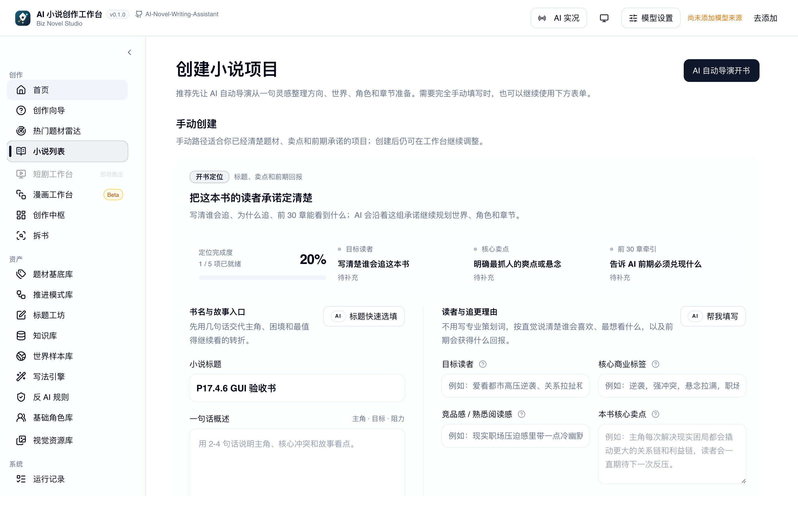
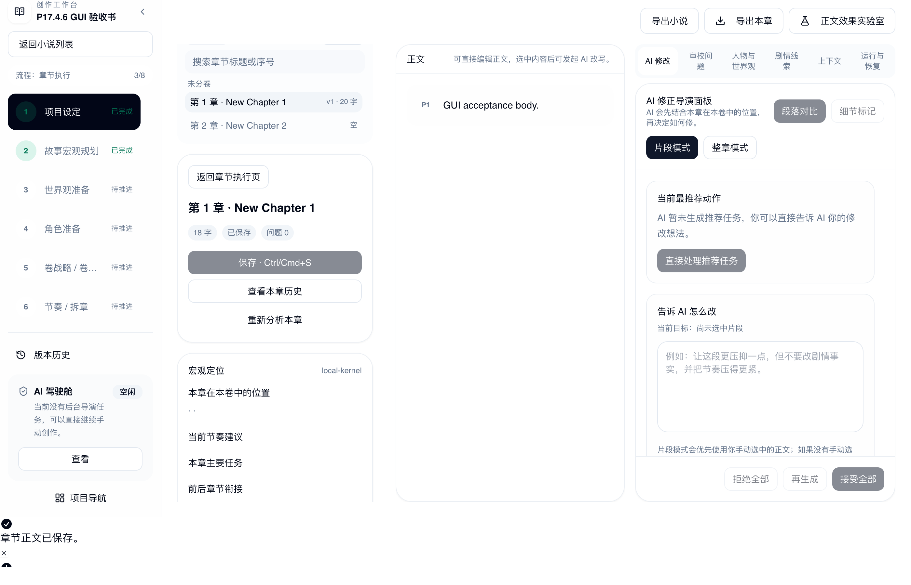
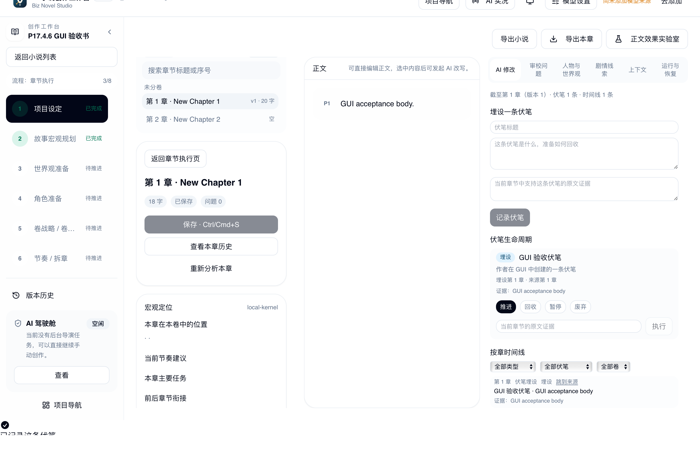
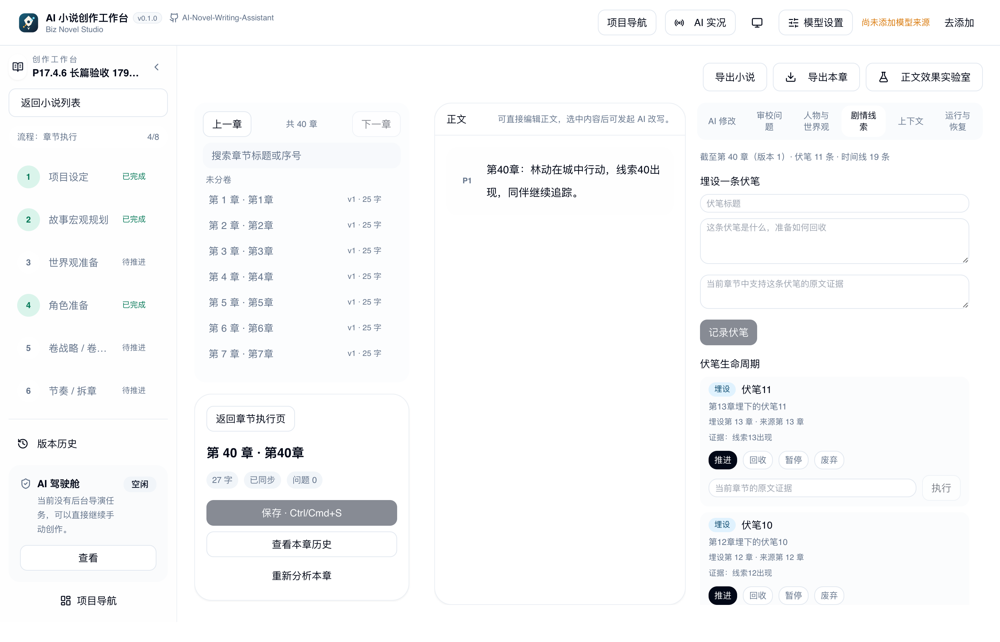

# P17.4.6 Beta 稳定性集成、创作验收与产品质量评测

## 结论

建议状态：`BETA_PRODUCT_ACCEPTANCE_PENDING`。

- **Engineering Acceptance：通过**。PR #13、#12 已合并；最终 beta CI（Tauri + Server）成功；
  P17.4.5 稳定性修复、14 个 Native E2E、40 章长篇自动化验收通过。
- **Product Acceptance：未完成**。真实桌面 GUI 的自动化路径已执行并截图，但**人工 GUI 验收**
  与**真实模型生成质量评测**均为 `NOT_RUN`；不能标记为完全通过或直接公开 Beta。

## 1. 最终 beta

| 项 | 值 |
| --- | --- |
| `origin/beta` | `e6060c5b0b45eff6b9ac216198183479daefbaee` |
| `origin/main` | `eff69f229727ab90f4102c05cfc705116cb1ded5`（未修改） |
| PR #13 | https://github.com/baicie/AI-Novel-Writing-Assistant/pull/13，MERGED |
| PR #13 merge commit | `3a26b82b969b442901069356d78cb4e302f3b38a`（父：`6b3654dd` + `45adaeeb`） |
| PR #12 | https://github.com/baicie/AI-Novel-Writing-Assistant/pull/12，MERGED |
| PR #12 merge commit | `e6060c5b0b45eff6b9ac216198183479daefbaee`（父：`3a26b82b` + `8923046e`） |

最终 beta 相对 `6b3654dd`：5 个文件，+745 / -26。内容仅为：
P17.4.5 稳定性测试/Server CI/文档，以及 P17.4.3/P17.4.4 历史文档。

## 2. PR #13 审查与合并

- Head 固定为 `45adaeeb171978dae40b1266be65c25f6844f014`；Base `beta`；Draft → Ready 后以
  **Create a merge commit** 合并。
- 二次审查：
  - worker marker 在 claim 成功后写入；提前退出立即失败；超时/异常路径 kill + wait，无残留 worker。
  - 测试临时 SQLite 在 tempdir 内，失败不残留共享数据库。
  - 30s 为有界安全截止；正常 claim 1–3s，未用无限等待或跳过断言。
  - Server CI 无凭据、无真实用户数据；使用 `/tmp` 临时 SQLite；paths 覆盖 `server/**`、`shared/**`、
    lockfile、workflow。
  - 未把 Server CI 配置为全局 required check；当前按 paths 运行。若后续要设为 required，
    需要移除 paths 过滤或增加 always-run gate，否则纯前端 PR 会因 skipped 处于 pending。
- 合并后 beta push CI：
  - Tauri CI run `42071155860`：success。
  - Server CI run `42071155846`：success。
  - 未删除 `fix/p17-4-5-beta-stability` 分支。

## 3. PR #12 文档处置

- PR #12 仅包含 `docs/design/P17.4.3...` 与 `P17.4.4...` 两份历史验收文档，无代码。
- 为 P17.4.4 增加“历史验收记录”标注：其记录的 beta 是合并当时的 `6b3654dd`，当前状态以本文档为准。
- Base 切到 beta 后 Files Changed 仅 2 个文档；CI 无代码检查；已以 merge commit 合并。
- 未修改任何产品代码。

## 4. Engineering Acceptance

| 检查 | 结果 |
| --- | --- |
| PR #13 Rust / 前端 / 发布脚本 / Linux Bundle / macOS Bundle / Kernel | 全部 pass |
| PR #13 Server CI（临时 SQLite） | **1934 tests / 1922 pass / 0 fail / 12 skipped** |
| beta push Tauri CI | success |
| beta push Server CI | success |
| P17.4.5 测试稳定性 | index worker 30/30；storage 10/10；workspace 10/10；chapter_history 30/30 |
| 14 个 Native E2E（修复构建） | **14/14 pass** |
| 双进程重启（beta 基线） | 6 + 1 pass |
| 索引 worker 崩溃恢复 / 备份中断恢复 | PASS / PASS |
| 迁移 0025→0026→0027 | 通过（test-harness） |
| 未解决 P0/P1 | 除下述已修复 P1 外为 0 |

### 本轮发现并修复的 P1

**桌面手动创建落入未接入本地内核的简易书架。**

- 复现：真实桌面应用 → 新建小说 → 填书名 → 创建；跳转到 `/novels/{id}/simple`，页面显示
  “这个功能暂未接入桌面本地内核”，无法进入章节执行。
- 根因：`buildNovelCreatePayload` 未发送 `creationExperience`；桌面 `create_novel_with_setup`
  默认 `Simple`。手动创建页实际填写的是专业创作字段。
- 修复：手动创建负载固定 `creationExperience: "professional"`；新增客户端回归断言。
- 代码：`client/src/pages/novels/novelBasicInfo.shared.ts`；
  测试：`client/src/pages/novels/novelReferenceCreation.test.mjs`。
- 验证：真实 GUI 创建后进入 `/edit?stage=chapter`；客户端 290/290 通过。

## 5. GUI 实测矩阵

使用真实构建的 Tauri 桌面应用（E2E 构建）、真实 SQLite、真实 UI；截图见
`docs/reviews/assets/p17-4-6/`。

| 项目 | 方式 | 结果 |
| --- | --- | --- |
| 新建小说（标题、专业创作） | 真实 UI 表单 | 通过 |
| 新建章节（新建章节按钮） | 真实 UI | 通过（2 章） |
| 正文输入与保存 | 真实 UI 编辑器 + 保存按钮 | 通过（保存后 `get_chapter` 正文一致） |
| 剧情线索页签、创建伏笔 | 真实 UI | 通过（伏笔卡片与时间线出现） |
| 章节切换 / 未保存守卫 | 既有 `p17-edit-position`、`p17-cancel-navigation` Native E2E | 通过（自动化） |
| 长正文滚动/定位/键盘 | 既有 `p17-edit-position` Native E2E | 通过（自动化） |
| 多角色连续性 As-Of | 40 章长篇验收 + As-Of 查询 | 通过（自动化） |
| 伏笔生命周期 | `p17-4` Native E2E + 40 章长篇 | 通过（自动化） |
| 因果环拒绝/端点失效 | `p17-4` + 40 章长篇 | 通过（自动化） |
| 退出/重启/继续 | beta 双进程重启 E2E | 通过（自动化） |
| **人工 GUI 点击验收** | 人工 | **NOT_RUN** |

截图：

- 
- 
- 
- 

## 6. 40 章长篇验收

验收脚本：`e2e/p17-4-6-long-form.e2e.js`（通过真实桌面 IPC 按作者顺序创建，不直接写数据库）。

数据与路径：

- 40 章连续正文，按 1→40 顺序创建与保存；
- 6 个角色（林动、苏晚、陆沉、阿福、沈青、黑衣人）；
- 11 条伏笔（第 3–13 章埋设；主伏笔第 8 章推进、第 15 章暂停、第 25 章回收）；
- 时间线事件 5 条 + 人物状态 5 条；
- 第 10/20/30 章各一次正文修订；
- 第 10 章伏笔来源失效后，第 30 章新证据恢复；
- A→B→C→D 因果链，D→A 被拒绝；
- 在真实章节工作台检查第 5/20/40 章。

结果：

- 第 5 章主伏笔 `open`，看不到第 25 章回收；
- 第 15 章 `deferred`；
- 第 20 章第 10 章伏笔 `stale`；
- 第 40 章主伏笔 `resolved`，恢复伏笔 `developing`；
- 第 5 章看不到第 10 章人物状态；第 10 章事件失效后不再进入 story facts；
- 因果边 3 条，循环请求被拒绝；
- GUI 脚本 2 个用例通过，耗时 9.6s（不含应用启动）。

## 7. 模型质量评测

**NOT_RUN**。本轮禁止自动调用付费模型；未使用任何 API Key，也未写入仓库/日志/截图。

评测体系已准备（见下），等待用户明确授权模型、预算与配置后执行：

| 场景 | 状态 |
| --- | --- |
| 新小说第一章生成 | NOT_RUN |
| 基于上一章续写 | NOT_RUN |
| 多角色对话 | NOT_RUN |
| 长距离人物连续性 | NOT_RUN |
| 伏笔暗示 / 推进 / 回收 | NOT_RUN |
| 已确认事实冲突防护 | NOT_RUN |
| 修改正文后的重新生成 | NOT_RUN |
| 长篇多轮 Director 创作 | NOT_RUN |

评分维度：文学表达、情节连贯、人物一致性、世界观一致性、伏笔质量、创作可控性、
上下文利用、修改成本（1–5 分）；同时记录生成耗时、输入/输出 token、模型配置、
估算费用、失败原因、人工修改次数/字数比例、未来剧情泄漏、已确认事实冲突。
未执行前不得给出 Mock 推测分数。

## 8. 性能与编辑器体验

沿用 P17.4.5 基线并补充：

- 100/500/1000 章：context p50 3.4 / 11.0 / 20.3ms；搜索 p50 1.1 / 8.0 / 17.3ms；
  1000 章 DB 50MB（详见 P17.4.5）。
- 40 章真实样本：创建+保存+11 条伏笔+3 次修订+因果链+四次工作台检查，自动化用例 9.6s。
- GUI 保存后正文一致；章节列表、伏笔卡片、时间线正常刷新。
- 观察到的体验问题：新章节默认标题为英文 `New Chapter 1/2`；40 章时左侧章节列表只显示约 7 条，
  需要滚动；时间线/伏笔列表无分页；快速连续点击“新建章节”时按钮可能长时间不可用（自动化中偶发，
  需要人工确认是否为真实交互问题）。

## 9. P0/P1/P2/P3

### P0

无。

### P1

- **已修复**：桌面手动创建进入未接入本地内核的简易书架（见第 4 节）。
- 无其它未关闭 P1。

### P2

1. 新章节默认标题为英文 `New Chapter N`，应使用中文/可配置标题。
2. 快速连续创建章节时按钮可能长时间 disabled；自动化中偶发，需人工复现确认。
3. 时间线 500 条截断、伏笔列表截断提示、服务端分页未实现。
4. 因果边列表无分页。
5. 旧 Director 伏笔写入入口仍未统一到证据流程。
6. 手工时间线/人物事实的可信来源策略未统一。
7. `plot_thread(novel_id)` 索引缺失；长篇查询需观察。
8. Server CI 尚未配置为全局 required check；paths 跳过时无 always-run gate。

### P3

- 章节列表在 40 章时可视区域偏短；伏笔时间线状态标签与筛选的视觉层级可继续优化。
- 创建表单较长，关键字段（章节预估）在首屏以下。

## 10. 公开 Beta 条件

Engineering Acceptance 已满足；Product Acceptance 未满足：

- 人工 GUI 验收未执行（A/B/C/D/E 全部需要人工确认实际体验与误操作）；
- 真实模型质量评测未执行；
- P2 中章节默认标题、快速创建按钮、长篇分页需在公测前明确处理或写入已知限制。

因此**不建议现在启动公开 Beta**，状态为 `BETA_PRODUCT_ACCEPTANCE_PENDING`。

## 11. 下一步建议

1. 由产品验收人员执行本文档第 5 节的 GUI 矩阵，并记录问题/截图。
2. 在用户授权模型、预算、配置后执行第 7 节 10 个场景的评测；禁止使用未授权 Key。
3. 修复 P2-1（中文默认章节标题）与 P2-2（快速新建章节按钮）——若人工确认成立则升为 P1。
4. 评估时间线/伏笔/因果边分页，按长篇实际使用反馈决定是否进入下一轮。
5. **暂不进入 P17.5 功能开发**；先完成 Beta 产品验收与模型质量门禁。

## 12. 复现命令

```bash
# 真实 GUI 验收（需先构建 E2E 应用）
BIZ_NOVEL_DATA_DIR=$(mktemp -d) pnpm e2e --spec ./e2e/p17-4-6-gui-acceptance.e2e.js

# 40 章长篇验收
BIZ_NOVEL_DATA_DIR=$(mktemp -d) pnpm e2e --spec ./e2e/p17-4-6-long-form.e2e.js

# 既有 14 个 Native E2E
pnpm build:tauri:e2e
bash scripts/run-p172-e2e-isolated.sh
```

所有数据目录独立，不接触用户正式作品；不调用付费模型。
